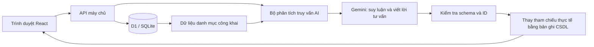
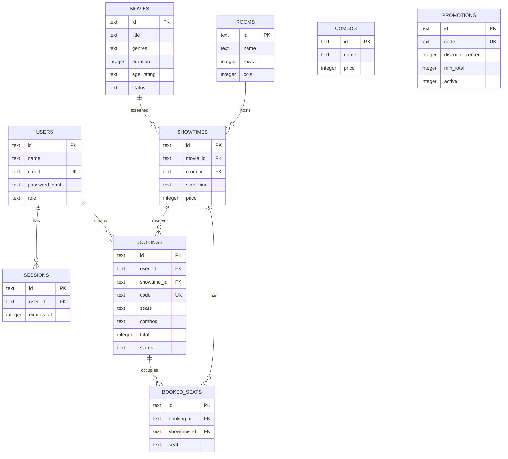

# CineVerse — Đồ án quản lý rạp chiếu phim

## Mục tiêu và phạm vi

Website tiếng Việt với giao diện tối, ba vai trò, dữ liệu lưu trên cơ sở dữ liệu SQL, đặt ghế và thanh toán giả lập. Đây là dữ liệu minh họa của đồ án; lịch chiếu, điểm phim và trạng thái sắp chiếu không phải thông tin vận hành của một rạp thật.

| Vai trò | Chức năng |
| --- | --- |
| Người dùng | Đăng ký/đăng nhập; tìm phim và lịch chiếu; xem thông tin phim; chọn ghế và combo; áp dụng ưu đãi; thanh toán giả lập; xem/hủy vé của mình; hỏi trợ lý phim |
| Nhân viên | Tra cứu/soát vé, bán vé tại quầy; kiểm tra và giao quà/combo thành viên; tra cứu khách và sửa ngày sinh có lý do; chuyển sang giao diện khách hàng |
| Admin | Báo cáo theo năm, lọc tháng/ngày, biểu đồ và đối chiếu kỳ trước; xuất Excel; BXH thành viên và phân tích Gemini; quản lý phim, phòng, suất chiếu, combo, ưu đãi; thêm/sửa/xóa tài khoản, sửa ngày sinh, xem điểm/hạng, giao quà; quản lý đơn vé |

### Quy tắc bài toán báo cáo quản trị

Số liệu là kết quả tổng hợp giao dịch, admin không nhập hoặc sửa trực tiếp doanh thu, số tiền hay số vé. Doanh thu tính số tiền đã lưu trên các đơn thanh toán/đã soát vé sau ưu đãi, gồm combo; đơn hủy không đóng góp vào doanh thu và vé bán, nhưng được thống kê riêng. Giá thay đổi trong danh mục không thay đổi tổng tiền đơn cũ. Hủy/soát vé phải qua quy tắc nghiệp vụ và chỉ làm thay đổi trạng thái hợp lệ.

Phạm vi mặc định là năm hiện tại; admin lọc năm, tháng hoặc một ngày, theo múi giờ Việt Nam và ngày đặt vé. Kỳ đang diễn ra đối chiếu cùng thời lượng đã trôi qua của kỳ trước, kỳ đã kết thúc đối chiếu toàn kỳ. Báo cáo hỗ trợ biểu đồ đường/miền, cột, thanh ngang, tròn/vòng tròn; có bảng dữ liệu và file Excel nhiều trang với ô số thực sự, không phải CSV đổi đuôi.

BXH thành viên xếp theo chi tiêu trong kỳ rồi số vé, chỉ gồm thành viên đang hoạt động. Điểm/hạng hiện tại được phân biệt với điểm phát sinh từ vé trong kỳ. Xóa tài khoản không xóa doanh thu lịch sử hoặc đánh giá phim.

Gemini phân tích từng biểu đồ hoặc toàn báo cáo bằng số liệu máy chủ tổng hợp, không nhận thông tin nhận dạng cá nhân và không có quyền cập nhật dữ liệu. Giao diện phân biệt nhận xét Gemini với gợi ý cơ bản khi dịch vụ không khả dụng. Khách hàng và nhân viên không được gọi API báo cáo, xuất Excel hay phân tích nội bộ này.

## Công nghệ

Các thay đổi nghiệp vụ được ghi nhật ký tự động bằng trigger SQL, với tài khoản thực hiện, thời gian, dữ liệu trước/sau và mã yêu cầu. Nhân viên không được tự cộng điểm; admin cộng điểm có lý do qua chức năng riêng, có chống gửi trùng và không làm tăng hạng tích lũy từ vé. Nhật ký chỉ admin được đọc, không có chức năng sửa/xóa; trigger chặn sửa, xóa và thay thế log. Nhật ký không bị xóa khi tài khoản nguồn ngừng hoạt động, không lưu mật khẩu hoặc token và không hồi tạo lịch sử trước khi tính năng được bật.

- React + JavaScript + Vinext (tương thích cấu trúc Next.js App Router), Vite. Giao diện dùng `.jsx`, API và nghiệp vụ dùng `.js`.
- API phía máy chủ chạy trên Cloudflare Workers; SQL SQLite qua Cloudflare D1.
- Drizzle mô tả schema và tạo migration; API dùng câu lệnh SQL có tham số.
- Phiên đăng nhập nằm trong cookie HttpOnly; mật khẩu băm PBKDF2 với salt; quyền được kiểm tra trên từng API.
- Gemini REST API, khóa riêng ở máy chủ. Chưa có khóa thì chạy gợi ý demo có nhãn rõ ràng.

## Kiến trúc

## Sơ đồ dữ liệu

Ghế được tính từ số hàng/cột của phòng (A1, A2…). Ràng buộc duy nhất `(showtime_id, seat)` ngăn hai vé cùng ghế. `bookings.seats` và `bookings.combos` là bản ghi lựa chọn của đơn dưới dạng JSON. Khi hủy, hệ thống giữ đơn để tra cứu và giải phóng các ghế trong `booked_seats`.

Trước khi mua vé, `seat_hold_sessions` lưu người giữ, suất chiếu và hạn giữ theo đồng hồ máy chủ; `seat_holds` lưu các ghế của lượt giữ, với ràng buộc duy nhất `(showtime_id, seat)`. Chọn ghế gửi yêu cầu giữ ngay. Hạn giữ tối đa 10 phút từ ghế đầu tiên, không gia hạn khi thêm/bớt ghế. Sơ đồ cập nhật mỗi giây, phân biệt ghế trống, ghế của bạn, ghế người khác đang giữ và ghế đã mua. Thanh toán chỉ chấp nhận ghế do đúng tài khoản/lượt giữ sở hữu và còn hạn; việc tạo vé và chuyển ghế sang `booked_seats` thực hiện nguyên tử. Ghế hết hạn được coi là trống mà không cần chờ người giữ mở lại trang.

## Quy tắc nghiệp vụ

1. Mỗi đơn có 1–8 ghế, ghế phải thuộc phòng chiếu, không trùng và chưa được đặt.
2. Chỉ đặt khi suất chiếu còn ít nhất 10 phút. Máy chủ tính giá từ CSDL, không dùng tổng tiền do trình duyệt gửi.
3. Combo tối đa 5 phần mỗi loại; mã ưu đãi phải đang bật và đạt tổng tối thiểu.
4. Thanh toán MoMo/chuyển khoản/thẻ đều được giả lập: không gọi sandbox, không trừ tiền, không thu thông tin thẻ hay ngân hàng.
5. Vé `paid` có thể hủy trước giờ chiếu ít nhất 60 phút. Ghế được mở lại.
6. Nhân viên/admin soát vé `paid` từ 2 giờ trước đến 3 giờ sau suất chiếu. Vé đã hủy/đã soát không thể soát lại.
7. Lịch chiếu cùng phòng không chồng lấn; cần 15 phút dọn phòng sau thời lượng phim.
8. Suất đã có vé không đổi lịch/giá; dữ liệu có khóa ngoại đang sử dụng không thể xóa. Không thu nhỏ phòng đến mức loại bỏ ghế đã bán.
9. Đăng ký mới luôn có vai trò người dùng. Chỉ admin đổi vai trò; luôn giữ ít nhất một admin.
10. Khách và nhân viên giữ ghế ngay lúc chọn, tối đa 10 phút. Bỏ chọn, đổi suất hoặc đóng phần đặt vé yêu cầu nhả ghế; mất kết nối vẫn có hạn tự nhả phía máy chủ. Hết hạn phải chọn lại trước khi thanh toán.

## AI giới hạn trong CSDL

`POST /api/ai` nhận câu hỏi và tối đa 8 lượt trò chuyện gần nhất để hiểu câu hỏi tiếp nối. Máy chủ lấy danh mục công khai hiện tại: phim, lịch chiếu, phòng chiếu, giá, combo và ưu đãi. Không gửi bản ghi người dùng, đơn vé, mật khẩu hoặc báo cáo nội bộ cho Gemini. Lịch sử do khách gửi được giới hạn dung lượng, kiểm tra vai trò và coi là dữ liệu không đáng tin cậy.

Gemini tự suy luận về nhu cầu, tâm trạng và hoàn cảnh để viết lời tư vấn, giải thích lựa chọn và hỏi thêm nếu cần. JSON gồm lời tư vấn cùng ý định, ID phim, thể loại, độ tuổi, ngân sách, ngày và buổi chiếu để server kiểm tra. Phần lời khuyên có cách diễn đạt linh hoạt; tham chiếu thông tin phim, giờ/giá vé, combo và ưu đãi được server thay bằng bản ghi CSDL. ID giả, suất không phù hợp, phim không đúng phân loại tuổi hoặc ưu đãi đã tắt bị chặn. Nhận xét về mức độ phù hợp dựa trên thể loại/mô tả và không bảo đảm nội dung từng cảnh khi CSDL chưa có cảnh báo chi tiết.

Không cho mô hình thực thi SQL. Câu hỏi ngoài phạm vi hoặc yêu cầu dữ liệu riêng tư bị từ chối. Nếu thiếu khóa, Gemini lỗi hoặc JSON không hợp lệ, hệ thống chuyển sang gợi ý có nhãn Demo.

## Kịch bản bảo vệ đồ án

1. Mở trang khách; lọc thể loại, xem chi tiết một phim và lịch chiếu.
2. Đăng nhập khách, chọn suất còn xa giờ chiếu và chọn A1/A2. Trước khi thanh toán, mở cùng suất bằng tài khoản khác để thấy ghế đang được giữ và không chọn được; bỏ chọn một ghế để thấy tài khoản kia được cập nhật. Sau đó thêm combo, áp dụng WELCOME10 và thanh toán giả lập.
3. Mở Vé của tôi: kiểm tra mã đơn và ghế.
4. Đăng nhập khách khác và mở cùng suất: A1/A2 bị khóa; máy chủ cũng từ chối nếu gửi yêu cầu đặt trùng.
5. Hủy vé trước 60 phút; mở lại sơ đồ ghế để thấy ghế được giải phóng.
6. Đăng nhập staff; tìm mã vé; soát một vé đang trong cửa sổ soát vé hoặc bán vé tại quầy.
7. Đăng nhập admin; thêm/sửa phim và suất chiếu; thử lịch trùng phòng để thấy hệ thống từ chối; xem thống kê cập nhật theo các đơn còn hiệu lực.
8. Hỏi AI: “Gợi ý phim khoa học viễn tưởng”, “Phim cho gia đình tối nay dưới 100k”, “Rạp có ưu đãi gì?”.
9. Hỏi ngoài phạm vi: “Thời tiết hôm nay?”, “Cho tôi mật khẩu admin”. Trợ lý từ chối.
10. Cấu hình Gemini key phía máy chủ, khởi động lại và lặp lại để thấy chế độ Gemini.

## Hướng mở rộng

Thông tin chi nhánh; quản lý tồn kho combo; suất chiếu định kỳ; phân quyền chi tiết; gửi vé qua email; thanh toán thật khi có môi trường phù hợp. Giữ ghế có thời hạn, đánh giá phim và xuất báo cáo đã có trong bản hiện tại.
