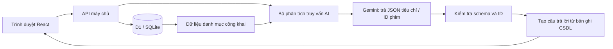
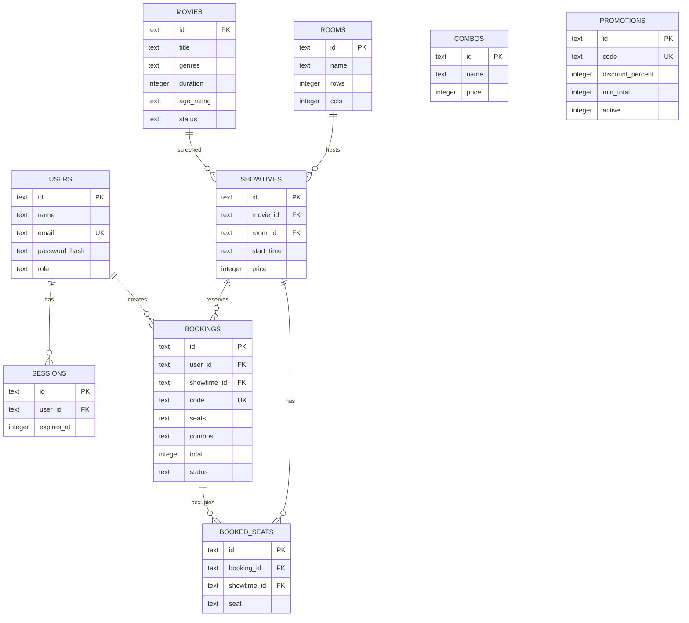

# CineVerse — Đồ án quản lý rạp chiếu phim

## Mục tiêu và phạm vi

Website tiếng Việt với giao diện tối, ba vai trò, dữ liệu lưu trên cơ sở dữ liệu SQL, đặt ghế và thanh toán giả lập. Đây là dữ liệu minh họa của đồ án; lịch chiếu, điểm phim và trạng thái sắp chiếu không phải thông tin vận hành của một rạp thật.

| Vai trò | Chức năng |
| --- | --- |
| Người dùng | Đăng ký/đăng nhập; tìm phim và lịch chiếu; xem thông tin phim; chọn ghế và combo; áp dụng ưu đãi; thanh toán giả lập; xem/hủy vé của mình; hỏi trợ lý phim |
| Nhân viên | Tra cứu vé, kiểm tra và soát vé; bán vé tại quầy với chọn ghế/combo/thanh toán giả lập; chuyển sang giao diện khách hàng |
| Admin | Thống kê doanh thu và vé; quản lý phim, phòng, suất chiếu, combo, ưu đãi; quản lý vai trò tài khoản; quản lý đơn vé |

## Công nghệ

- React + TypeScript + Vinext (tương thích cấu trúc Next.js App Router), Vite.
- API phía máy chủ chạy trên Cloudflare Workers; SQL SQLite qua Cloudflare D1.
- Drizzle mô tả schema và tạo migration; API dùng câu lệnh SQL có tham số.
- Phiên đăng nhập nằm trong cookie HttpOnly; mật khẩu băm PBKDF2 với salt; quyền được kiểm tra trên từng API.
- Gemini REST API, khóa riêng ở máy chủ. Chưa có khóa thì chạy gợi ý demo có nhãn rõ ràng.

## Kiến trúc

## Sơ đồ dữ liệu

Ghế được tính từ số hàng/cột của phòng (A1, A2…). Ràng buộc duy nhất `(showtime_id, seat)` ngăn hai vé cùng ghế. `bookings.seats` và `bookings.combos` là bản ghi lựa chọn của đơn dưới dạng JSON. Khi hủy, hệ thống giữ đơn để tra cứu và giải phóng các ghế trong `booked_seats`.

## Quy tắc nghiệp vụ

1. Mỗi đơn có 1–8 ghế, ghế phải thuộc phòng chiếu, không trùng và chưa được đặt.
2. Chỉ đặt khi suất chiếu còn ít nhất 10 phút. Máy chủ tính giá từ CSDL, không dùng tổng tiền do trình duyệt gửi.
3. Combo tối đa 5 phần mỗi loại; mã ưu đãi phải đang bật và đạt tổng tối thiểu.
4. Thanh toán MoMo/chuyển khoản/thẻ đều được giả lập: không gọi sandbox, không trừ tiền, không thu thông tin thẻ hay ngân hàng.
5. Vé `paid` có thể hủy trước giờ chiếu ít nhất 60 phút. Ghế được mở lại.
6. Nhân viên/admin soát vé `paid` từ 2 giờ trước đến 3 giờ sau suất chiếu. Vé đã hủy/đã soát không thể soát lại.
7. Lịch chiếu cùng phòng không chồng lấn; cần 15 phút dọn phòng sau thời lượng phim.
8. Suất đã có vé không đổi lịch/giá; dữ liệu có khóa ngoại đang sử dụng không thể xóa. Không thu nhỏ phòng đến mức loại bỏ ghế đã bán.
9. Đăng ký mới luôn có vai trò người dùng. Chỉ admin đổi vai trò; luôn giữ ít nhất một admin.

## AI giới hạn trong CSDL

`POST /api/ai` nhận một câu hỏi. Máy chủ lấy danh mục công khai hiện tại: phim, lịch chiếu, giá, combo và ưu đãi. Không gửi người dùng, đơn vé, mật khẩu hoặc báo cáo nội bộ cho Gemini.

Gemini trả JSON theo schema: ý định, ID phim hợp lệ, thể loại, độ tuổi, ngân sách, ngày và buổi chiếu. Hệ thống kiểm tra JSON và đối chiếu ID/tiêu chí với dữ liệu thật. Văn bản và các thông tin thực tế hiển thị cho khách được tạo lại từ bản ghi CSDL. Vì vậy một tên phim/giá/suất chiếu do mô hình tự tạo không thể xuất hiện trong câu trả lời thông qua JSON không hợp lệ.

Không cho mô hình thực thi SQL. Câu hỏi ngoài phạm vi hoặc yêu cầu dữ liệu riêng tư bị từ chối. Nếu thiếu khóa, Gemini lỗi hoặc JSON không hợp lệ, hệ thống chuyển sang gợi ý có nhãn Demo.

## Kịch bản bảo vệ đồ án

1. Mở trang khách; lọc thể loại, xem chi tiết một phim và lịch chiếu.
2. Đăng nhập khách, chọn suất còn xa giờ chiếu, đặt A1/A2, thêm combo, áp dụng WELCOME10, thanh toán giả lập.
3. Mở Vé của tôi: kiểm tra mã đơn và ghế.
4. Đăng nhập khách khác và mở cùng suất: A1/A2 bị khóa; máy chủ cũng từ chối nếu gửi yêu cầu đặt trùng.
5. Hủy vé trước 60 phút; mở lại sơ đồ ghế để thấy ghế được giải phóng.
6. Đăng nhập staff; tìm mã vé; soát một vé đang trong cửa sổ soát vé hoặc bán vé tại quầy.
7. Đăng nhập admin; thêm/sửa phim và suất chiếu; thử lịch trùng phòng để thấy hệ thống từ chối; xem thống kê cập nhật theo các đơn còn hiệu lực.
8. Hỏi AI: “Gợi ý phim khoa học viễn tưởng”, “Phim cho gia đình tối nay dưới 100k”, “Rạp có ưu đãi gì?”.
9. Hỏi ngoài phạm vi: “Thời tiết hôm nay?”, “Cho tôi mật khẩu admin”. Trợ lý từ chối.
10. Cấu hình Gemini key phía máy chủ, khởi động lại và lặp lại để thấy chế độ Gemini.

## Hướng mở rộng

Thông tin chi nhánh; quản lý tồn kho combo; trạng thái giữ ghế có thời hạn; đánh giá phim; suất chiếu định kỳ; phân quyền chi tiết; xuất báo cáo; gửi vé qua email; thanh toán thật khi có môi trường phù hợp. Bản hiện tại không có chức năng giữ ghế tạm: ghế được quyết định chính thức khi hoàn thành thanh toán giả lập.
